# FootureX Presentation OS

**Интерактивная 3D-веб-презентация «Управление проектами FootureX Uzbekistan»**
Защита университетского проекта по дисциплине «Управление проектами».

Онлайн: **https://footurexpptx.vercel.app/**

| | |
|---|---|
| Студент | Зафарбек Якубов, группа RB 25-01 |
| Преподаватель | Парвиз Мамедов |
| Университет | Tashkent International University of Education (TIUE), Ташкент, 2026 |
| Формат | 15 сцен, ≈10 минут, русский язык |

Это не слайды и не PDF: презентация — единое трёхмерное пространство FootureX (стадион
в фирменном синем свете и FootureX City), по которому перелетает виртуальная камера.
Каждая из 15 сцен — отдельный React-компонент с настоящим HTML-текстом, интерактивными
диаграммами и схемами поверх 3D-фона.

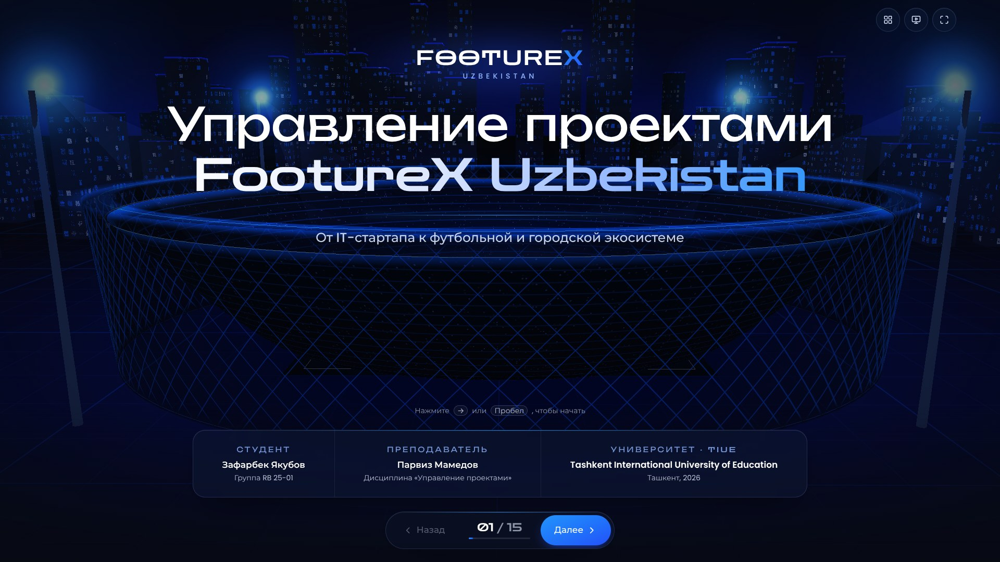

## Быстрый старт

Нужен Node.js 20.19+ (проверено на Node 22).

```bash
npm install
npm run dev        # http://localhost:5173
npm run build      # production-сборка в dist/
npm run preview    # просмотр сборки: http://localhost:4173
```

Сборка использует относительные пути (`base: './'`), поэтому `dist/` работает на любом
статическом хостинге и на GitHub Pages. Шрифты вшиты в сборку — интернет на защите не нужен.
Открывать `dist/index.html` двойным щелчком нельзя (браузер блокирует модули с `file://`) —
используйте `npm run preview`.

## Управление

| Действие | Как |
|---|---|
| Следующая сцена | **→**, **Пробел**, **PageDown**, кнопка «Далее», клик по свободной области, свайп влево |
| Предыдущая сцена | **←**, **PageUp**, кнопка «Назад», свайп вправо |
| Первая / последняя | **Home** / **End** |
| Список сцен | **M**, кнопка с сеткой справа вверху или счётчик `07 / 15` на нижней панели |
| Полный экран | **F** или кнопка справа вверху; выход — **Esc** или **F** |
| Окно докладчика | **S** или кнопка с монитором справа вверху |

- Пока идёт перелёт камеры (≈1,3 с), повторные команды блокируются — двойной клик
  или зажатая клавиша не пропускают сцены.
- Клик по кнопкам, карточкам, вкладкам, графикам и ссылкам не переключает сцену.
- Номер сцены хранится в адресе (`#/07`): перезагрузка не сбрасывает позицию,
  на сцену можно сослаться напрямую (`?scene=7`).

## Режим докладчика

Нажмите **S** — откроется отдельное окно (держите его на ноутбуке, а презентацию — на
проекторе в полноэкранном режиме). Окна синхронизируются через `BroadcastChannel`
в одном браузере, сервер не нужен.

В окне докладчика: номер и название текущей сцены, текст выступления (≈10 минут на 15 сцен),
следующая сцена, общий таймер с плановой отметкой «где вы должны быть сейчас»,
таймер текущей сцены и список сцен с хронометражом. Кнопки и стрелки в окне докладчика
листают основную презентацию. **T** — старт/пауза таймера; таймер стартует сам при первом
переходе. Текст выступления на основном экране не показывается.

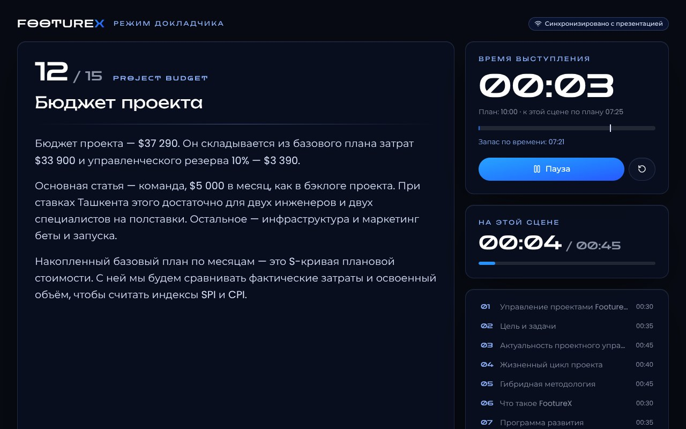

## 15 сцен

| № | Сцена | Что на экране |
|---|---|---|
| 01 | Открытие | Обложка на фоне стадиона, данные студента и преподавателя |
| 02 | Цель и задачи | Центральное ядро-цель и четыре интерактивные задачи со ссылками на сцены |
| 03 | Актуальность | Три проблемы — сроки и бюджет, нехватка специалистов, неопределённость стартапа — с проверенной статистикой |
| 04 | Жизненный цикл проекта | Пространственное кольцо из 5 групп процессов: инициация → … → завершение |
| 05 | Гибридная методология | Схема потоков: каскад этапа + Scrum-спринты + обратная связь метрик |
| 06 | Что такое FootureX | Голографический мяч, миссия «Creating a Digital Football Era» |
| 07 | Программа развития | Три этапа как три проекта программы; этапы 2 и 3 — планируемые |
| 08 | Устав проекта | Цель SMART, границы содержания, ограничения, критерии приёмки |
| 09 | Команда и стейкхолдеры | Матрица RACI, сетка «влияние / заинтересованность», план коммуникаций |
| 10 | WBS | Иерархическая структура работ: 4 результата, 13 пакетов, оценка и ёмкость команды |
| 11 | Календарный план | Диаграмма Ганта на 12 спринтов, критический путь, вехи M1–M5 |
| 12 | Бюджет проекта | Структура бюджета, управленческий резерв, S-кривая плановой стоимости |
| 13 | Управление рисками | Матрица «вероятность × влияние» и реестр рисков с мерами реагирования |
| 14 | Мониторинг, контроль и выводы | Сроки (SPI), бюджет (CPI), качество, ценность; выводы и рекомендации |
| 15 | Финал | «Спасибо за внимание!» и проверяемые источники 2021–2026 |

## Галерея

| | |
|---|---|
|  | 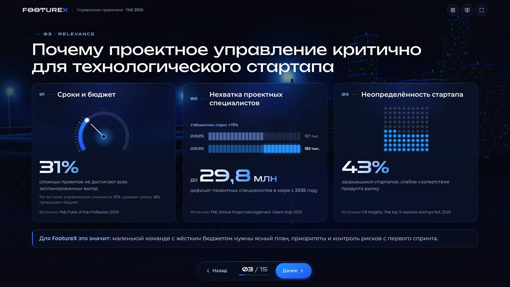 |
| 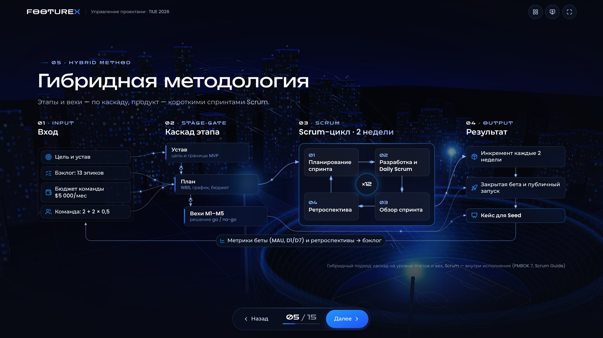 | 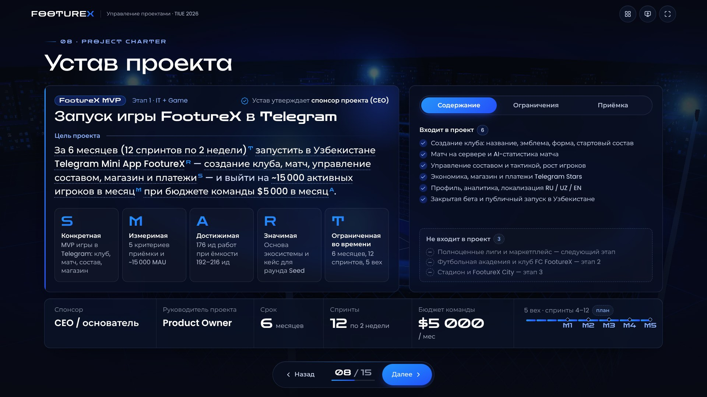 |
| 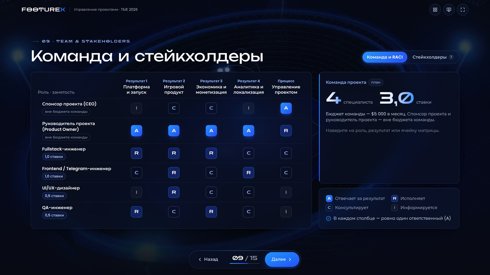 | 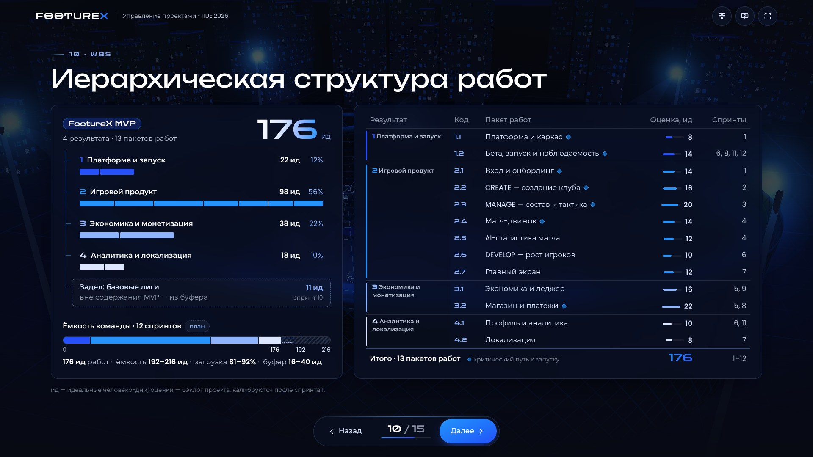 |
| 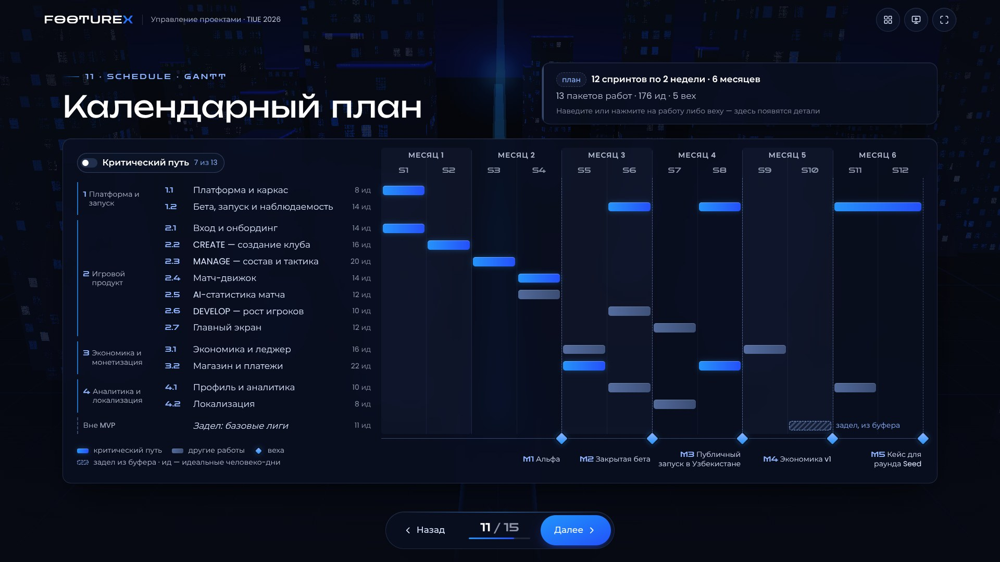 | 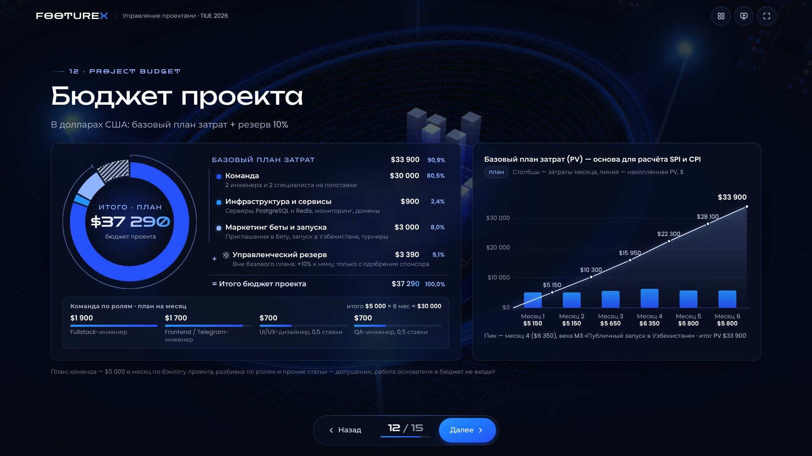 |
| 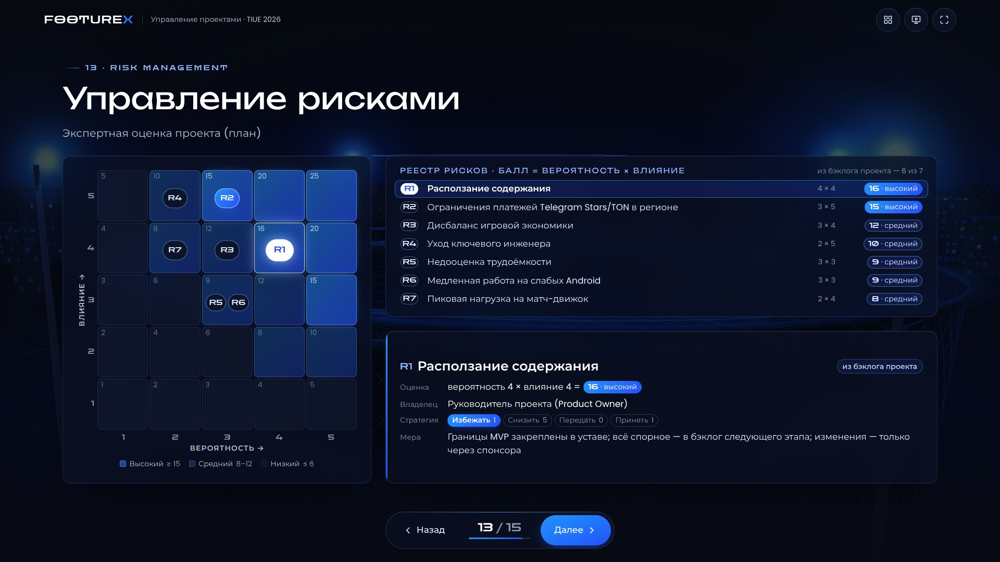 | 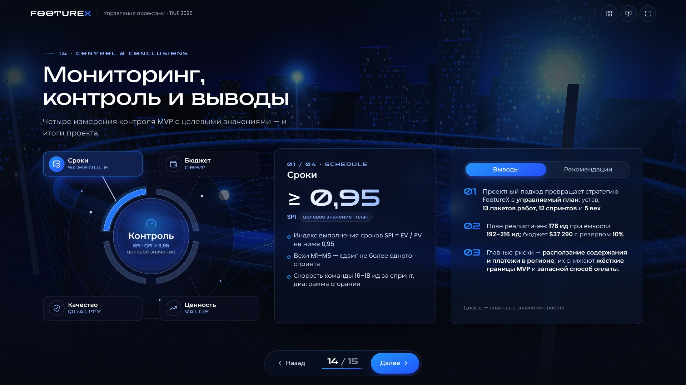 |

Телефон (390×844): раскладка перестраивается — карточки, аккордеоны и вкладки вместо широких схем.

| | | | |
|---|---|---|---|
| 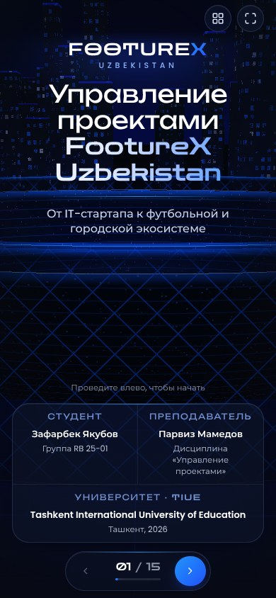 | 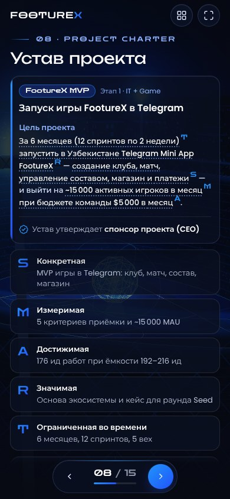 | 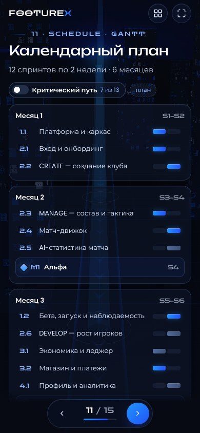 | 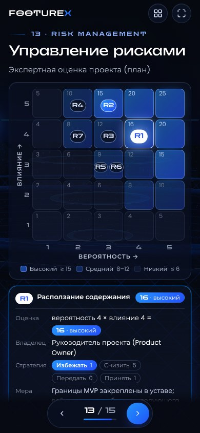 |

Скриншоты всех 15 сцен в 1920×1080 — в папке [docs/screenshots](docs/screenshots).

## Данные и расчёты

Разбирается проект **«FootureX MVP: запуск игры в Telegram»** — часть этапа 1 (IT + Game).
Все данные собраны в одном файле [`src/data/project.ts`](src/data/project.ts); таблицы, диаграммы,
итоги и текст выступления считаются из него кодом, поэтому всегда согласованы между собой.

- **Из бэклога проекта FootureX** (спринт-бэклог Stage 0): 6 месяцев, 12 спринтов по 2 недели,
  13 эпиков с оценками (176 идеальных человеко-дней), ёмкость команды 16–18 ид за спринт,
  бюджет команды $5 000 в месяц, вехи (альфа, закрытая бета, публичный запуск, экономика v1,
  кейс для Seed), цели по аудитории, критерии приёмки и основные риски.
- **Плановые допущения** (на слайдах помечены «план»): разбивка бюджета по ролям, инфраструктура
  и маркетинг, управленческий резерв 10%, оценки вероятности и влияния рисков, матрица RACI,
  стейкхолдеры, целевые показатели контроля (SPI и CPI ≥ 0,95 и др.).
- Бюджет: базовый план затрат $33 900 + управленческий резерв $3 390 = **$37 290** за 6 месяцев.
- Целевые показатели нигде не выдаются за достигнутые результаты.

Проверка фактов и источников: [docs/research-notes.md](docs/research-notes.md),
список литературы: [docs/SOURCES.md](docs/SOURCES.md). Согласованность расчётов:
`npm run test:sums`.

## Брендбук и айдентика

- **Цвета** — бренд-токены FootureX: `#0B0F0E` (база), `#0E1629` (поверхности),
  `#273B51` (линии), `#2550FA` (primary), `#2593FA` (secondary), `#8EB4FF` (highlight),
  градиент `135° #2593FA → #2550FA`. Токены: `src/styles/index.css` и `src/styles/tokens.ts`.
- **Шрифты** — Zen Dots (display) и Poppins (текст). В этих гарнитурах нет кириллицы,
  поэтому для русских символов браузер автоматически берёт ближайшие по геометрии
  шрифты с кириллицей: Unbounded (к Zen Dots) и Montserrat (к Poppins). Латиница, цифры
  и подписи остаются в Zen Dots и Poppins. Все шрифты вшиты через `@fontsource`.
- **Логотип.** PDF брендбука в репозиторий не прикладывался, и исходного файла логотипа
  в проекте нет, поэтому сейчас используется шрифтовой знак FOOTUREX (Zen Dots +
  фирменный градиент). Чтобы поставить оригинальный логотип:
  1. положите файл в `public/brand/`, например `public/brand/footurex-logo.svg`;
  2. в `src/components/brand/brand.ts` укажите `ORIGINAL_LOGO_SRC = './brand/footurex-logo.svg'`.
  Логотип сменится во всех местах (верхняя панель, обложка, финал, окно докладчика).

## Архитектура

```
src/
  app/          App, Stage (переходы GSAP, параллакс, клик/свайп), store (zustand),
                клавиатура, синхронизация и окно докладчика
  components/   scene/ (SceneFrame, SceneHeader, Reveal), ui/ (Glass, Stat, CountUp),
                nav/ (NavBar, TopBar, SceneMenu), backdrop/ (3D или CSS-фон), brand/
  scenes/       Scene01Opening.tsx … Scene15Final.tsx (+ папки sNN/ с частями сцен), registry.ts
  three/        World (Canvas), CameraRig, Stadium, City, Environment, features/ (объекты сцен)
  animations/   timing.ts — общие тайминги камеры и контента
  data/         scenes.ts (конфигурация 15 сцен), project.ts, sources.ts, speakerNotes.ts, relevance.ts
  hooks/        reduced motion, media queries, fullscreen
  styles/       дизайн-токены, типографика, glassmorphism
scripts/        screenshots.mjs, qa.mjs, nav-test.mjs (Playwright)
```

Как добавить или изменить сцену — [docs/DEVELOPMENT.md](docs/DEVELOPMENT.md).

Слои разделены: **3D-canvas** (фон, `pointer-events: none`) → **слой контента** (HTML-сцены)
→ **навигация**. Конфигурация сцен централизована в `src/data/scenes.ts`: порядок, ракурс
камеры, 3D-объекты сцены, затемнение фона, хронометраж.

### Как устроен переход

1. Команда «далее» блокирует навигацию до конца перехода.
2. Текущая сцена уходит в глубину (GSAP: масштаб 0,88, прозрачность, сдвиг против движения).
3. Камера перелетает по дуге вокруг стадиона (интерполяция угла, радиуса и высоты +
   мягкий подъём), 1,25 с, `power2.inOut`.
4. Следующая сцена появляется из глубины со стороны движения, элементы — каскадом.
5. После остановки камеры сцена получает `ready` — запускаются диаграммы и счётчики.

При `prefers-reduced-motion` переходы заменяются короткой сменой прозрачности, камера не
«дышит», параллакс и циклические анимации выключены.

## Производительность

- 3D-мир загружается лениво; до загрузки и без WebGL показывается CSS-фон.
- Город (≈560 зданий) — один `InstancedMesh`, окна рисует шейдер — без текстур.
- Анимации частиц, окон и потоков — в шейдерах, без пересоздания геометрии.
- Плотность пикселей ограничена 1,75 и автоматически снижается при FPS < 45.
- Объекты сцен скрываются целиком, когда не нужны; ресурсы освобождаются при размонтировании.
- Сцены загружаются лениво, соседние — заранее.
- Проверка без GPU: `?lite=1` — презентация без WebGL; `?fps=1` — счётчик кадров.

Целевые ≈60 FPS достижимы на ноутбуке с дискретной или современной встроенной графикой;
на слабых устройствах качество снижается автоматически, а при потере WebGL-контекста
презентация переключается на CSS-фон.

## Проверка качества

```bash
npm run typecheck      # TypeScript
npm run build          # production-сборка
npm run test:sums      # согласованность данных проекта: WBS, ёмкость, бюджет, RACI, риски, вехи
npm run test:nav       # навигация, клавиатура, блокировка повторов, меню, fullscreen, окно докладчика
npm run qa             # все 15 сцен × 5 разрешений: наложения текста, выход за кадр, мелкий шрифт, ошибки консоли
npm run shots -- --scenes all --sizes 1920x1080,1366x768,390x844
```

`test:nav`, `qa` и `shots` ожидают запущенный `npm run dev` (или передайте `--url`, например
`npm run qa -- --url http://localhost:4173/` для `npm run preview`). Chromium для Playwright
должен быть установлен (`npx playwright install chromium`) или указан в `CHROMIUM_PATH`.

### Что проверено перед публикацией (22.10.2026)

| Проверка | Результат |
|---|---|
| `tsc -b` | без ошибок |
| `npm run build` | успешно (локально и на Vercel) |
| Данные проекта: WBS, ёмкость, бюджет, RACI, риски, вехи (`npm run test:sums`) | все проверки пройдены |
| Навигация, клавиатура, меню, fullscreen, окно докладчика (production-сборка) | 26/26 |
| Вёрстка: 15 сцен × 1920×1080, 1600×900, 1366×768, 390×844, 844×390 (production-сборка) | 75/75 без замечаний |
| Интерактив сцен: клики, наведение, касания, вкладки, Tab — сцена не перелистывается | все сценарии пройдены |
| Режим без WebGL (`?lite=1`) и `prefers-reduced-motion` | работают |

Проверки выполнялись в headless Chromium с программным WebGL (без GPU), поэтому FPS там не
показателен; переход при этом укладывается в ≈1,35 с реального времени.
Плавность 60 FPS нужно оценить на вашем ноутбуке и проекторе — откройте `?fps=1`.

## Публикация в интернете

Сборка — статический сайт (`npm run build` → `dist/`), поэтому подходит любой хостинг.
Конфигурация для Vercel, Netlify и Cloudflare Pages уже лежит в репозитории
(`vercel.json`, `netlify.toml`, `public/_headers`, Node 22 в `.nvmrc`). После подключения
каждый push в `main` публикуется автоматически.

| Хостинг | Как подключить |
|---|---|
| **Vercel** | [](https://vercel.com/new/clone?repository-url=https%3A%2F%2Fgithub.com%2FJonyFrest%2FFootureX-Presentation&project-name=footurex-presentation) — войдите через GitHub и нажмите **Deploy**. Адрес: `https://<проект>.vercel.app` |
| **Netlify** | [](https://app.netlify.com/start/deploy?repository=https://github.com/JonyFrest/FootureX-Presentation) — войдите через GitHub и нажмите **Deploy**. Адрес: `https://<проект>.netlify.app` |
| **Cloudflare Pages** | Dashboard → **Workers & Pages** → **Create** → **Pages** → **Connect to Git** → репозиторий `FootureX-Presentation`; Framework preset **Vite** (Build command `npm run build`, Build output `dist`) → **Save and Deploy**. Адрес: `https://<проект>.pages.dev` |
| **GitHub Pages** | **Settings → Pages → Source: GitHub Actions**, затем перезапустите workflow `Deploy to GitHub Pages`. Адрес: `https://jonyfrest.github.io/FootureX-Presentation/` |

Публикация из командной строки (нужен токен сервиса в переменной окружения):

```bash
npm run build
npx vercel deploy --prod                                  # VERCEL_TOKEN
npx netlify-cli deploy --prod --dir=dist                  # NETLIFY_AUTH_TOKEN
npx wrangler pages deploy dist --project-name=footurex    # CLOUDFLARE_API_TOKEN + CLOUDFLARE_ACCOUNT_ID
```

## Технологии

React 19 · TypeScript 5.9 · Vite 7 · Three.js 0.186 · React Three Fiber 9 · GSAP 3 ·
Motion for React · Tailwind CSS 4 · Recharts 3 · Lucide Icons · Zustand · Playwright.
